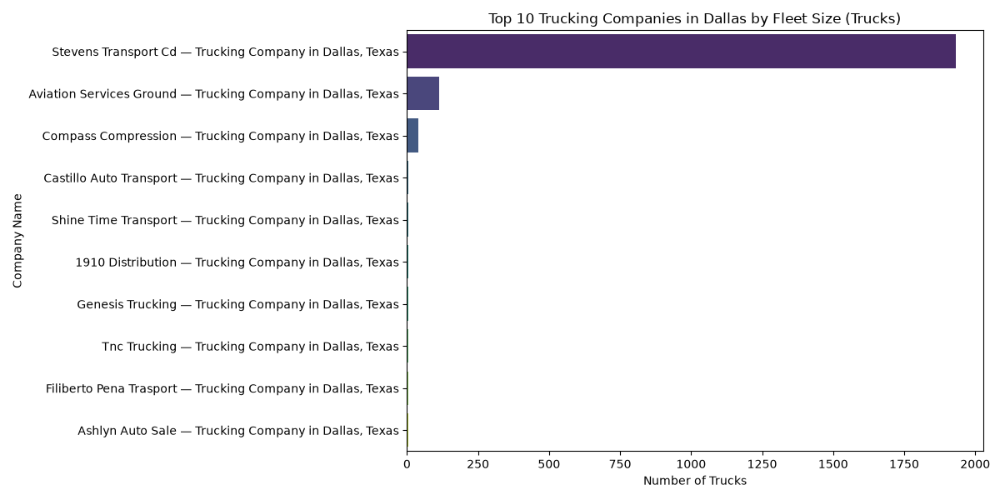

# dallas-trucking-scraperarkdown
# 🚚 Asynchronous Dallas Trucking Companies Scraper & Fleet Analyzer

An advanced, high-performance asynchronous web scraping and data analytics tool built with **Python**, **Playwright (Async API)**, **Asyncio**, and **Pandas**. It efficiently scrapes hundreds of trucking company profiles from Texas business directories, extracts fleet metrics via Regular Expressions, computes summary statistics, and generates visual market distribution charts.

## 🚀 Key Features
- **Asynchronous Concurrency (`asyncio`):** Utilizes non-blocking execution and semaphores (`asyncio.Semaphore`) to control concurrent page requests and speed up data extraction.
- **Dynamic Crawling & Regex Extraction:** Crawls through transport directory pages and uses Regular Expressions (`re`) to parse phone numbers, USDOT identifiers, truck fleets, and driver counts.
- **Fleet Analytics & Insights:** Computes key market indicators (largest fleet, average fleet size, and driver distribution).
- **Data Visualization:** Generates visual charts highlighting top transport operators in Dallas, Texas.

## 🛠️ Built With
- **Python 3.x**
- **Playwright (Async API)** (Browser Automation)
- **Asyncio & Re** (Concurrency & Data Extraction)
- **Pandas** (Data Processing)
- **Matplotlib & Seaborn** (Data Visualization)

## 📊 Fleet Insights Preview


## ⚙️ How to Run
1. Clone the repository:
   ```bash
   git clone [https://github.com/karamsjelnjjar-cloud/dallas-trucking-scraper.git](https://github.com/karamsjelnjjar-cloud/dallas-trucking-scraper.git)
Install dependencies:

Bash
pip install playwright pandas matplotlib seaborn openpyxl
playwright install
Run the async scraper:

Bash
python dallas_scraper.py
Run the fleet analysis script:

Bash
python analyze_dallas.py
